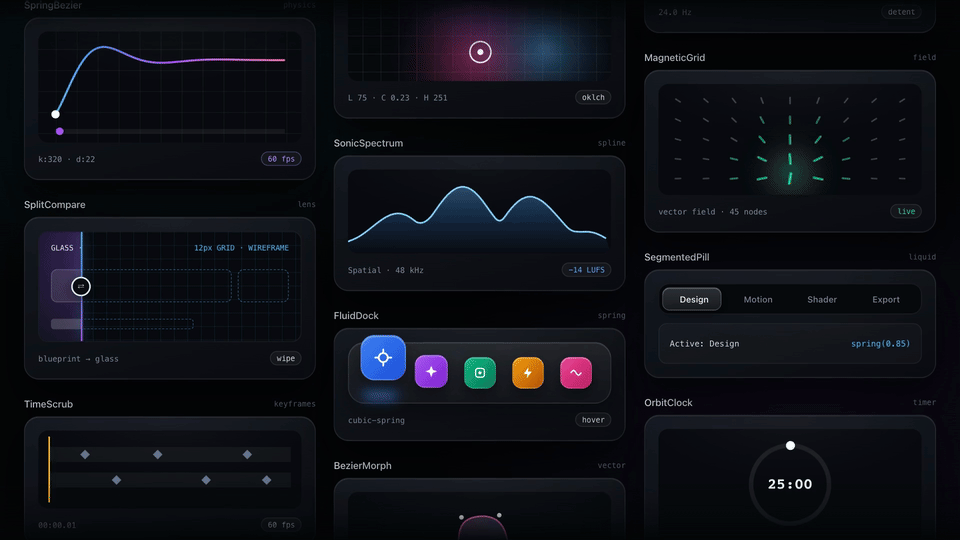

# tactile-uiux-skill

A super-customizable, token-driven design and engineering skill for building **graphic, physically responsive UI/UX components** across **web** and **mobile** applications.



[▶ Watch full 1080p 60fps showcase](docs/showcase.mp4)

## Why this skill

Most AI-generated UI falls back to flat cards, generic `transition-all` hovers, and stretched canvases. `tactile-ui` gives your coding agent a complete materiality, physics, and graphic-animation system:

- **Layered dark-glass materiality**: Three-tier depth hierarchy (`--tu-canvas` → `--tu-well` → `--tu-surface`), specular top rims, and localized radial lighting.
- **Graphic animations**: Coordinate-grid stages, luminous splines with fading velocity ghost trails, radial tick rings, 3D tilt sheen, and velocity-stretched liquid capsules.
- **Real physics & zero battery drain**: Interruptible spring-damper loops (`Spring` + `createLoop`) that sleep when settled and pause offscreen.
- **1:1 responsive geometry**: `ResizeObserver`-bound Canvas/SVG scaling (`bindResponsiveCanvas`) so circles, dials, and arcs never stretch into ellipses.
- **Zero AI Slop guardrails**: One focal graphic per component, restrained accents, `touch-action: none` + `setPointerCapture` for mobile/desktop scrubbing, `tabular-nums`, and `prefers-reduced-motion` support.

## Install

Works with any `SKILL.md` / `.agents/skills/` compatible agent (Antigravity, Claude Code, Codex, Cursor, OpenCode).

**Current project** (`.agents/skills/tactile-ui/`):
```bash
npx github:monoaster/tactile-uiux-skill
```

**Global** (`~/.gemini/config/skills/tactile-ui/`):
```bash
npx github:monoaster/tactile-uiux-skill --global
```

**Via `skills` CLI**:
```bash
npx skills add monoaster/tactile-uiux-skill
```

## Example Prompts

Once installed, ask your agent to build any custom component using the `tactile-ui` skill:

- *"Using `tactile-ui`, build a rotary gain knob in React with 48 radial ticks, pointer-captured drag, keyboard support, and mobile haptics."*
- *"Using `tactile-ui`, create a liquid segmented tab switcher whose active capsule stretches proportionally to spring velocity."*
- *"Using `tactile-ui`, design a 3D glass membership card with pointer-driven tilt and a moving holographic sheen."*

## Quick Theme Override

Every component reads `--tu-*` tokens, so re-theming takes a few lines:

```css
:root {
  --tu-accent: #fbbf24;   /* primary glow, active ticks, stroke */
  --tu-accent-2: #f472b6; /* secondary gradient stop */
  --tu-radius-card: 20px;
}
```

## Verify what the agent built

`scripts/check.mjs` renders a component at 1200 px and 375 px, in dark and light, and enforces the skill's rules:

```bash
npm i -D puppeteer-core            # uses your local Chrome; set CHROME_PATH or pass --chrome if it isn't found
node scripts/check.mjs path/to/component.html --out shots/     # or a URL; --scheme dark|light|both
```

It checks horizontal overflow, canvas 1:1 and sharpness, `touch-action`/`user-select`, slider semantics, `--tu-*` tokens, token and DOM text contrast,
tabular readouts, overlapping labels, forbidden patterns (`transition: all`, `hover:scale-*`, fixed `<canvas width>`), idle `requestAnimationFrame`
after load and after a drag, mouse and touch drag, keyboard nudging, focus ring, reduced motion, and console errors. It exits non-zero on any failure.
Still manual: a real phone, and judging whether it looks right.

## Reference component

[`examples/spline-eq.html`](examples/spline-eq.html) is a complete parametric EQ (spline with two draggable nodes, liquid preset capsule, telemetry footer,
scale labels, keyboard support, dark and light). It passes the checker; copy its structure when building something new.

## Platform scope

Web has the full path (primitives, reference component, checker). SwiftUI and React Native are covered by a mapping table in `SKILL.md` only:
no reference implementation or automated check yet.

## Contents

- `SKILL.md` — tokens (dark and light), physics config and units rule, graphic animation language, graph & stage conventions, accessibility, Zero AI Slop guardrails, platform scope, workflow
- `references/primitives.md` — CSS tokens, `bindResponsiveCanvas`, `Spring` + `createLoop`, stage grid and scale labels, ghost trail, glow, tick ring, gesture and keyboard primitives
- `examples/spline-eq.html` — complete reference component
- `scripts/check.mjs` — automated verification (see above)
- `CHANGELOG.md` — versioned changes
- `bin/install.mjs` — zero-dependency `npx` installer (ships the files above)

## License

MIT
